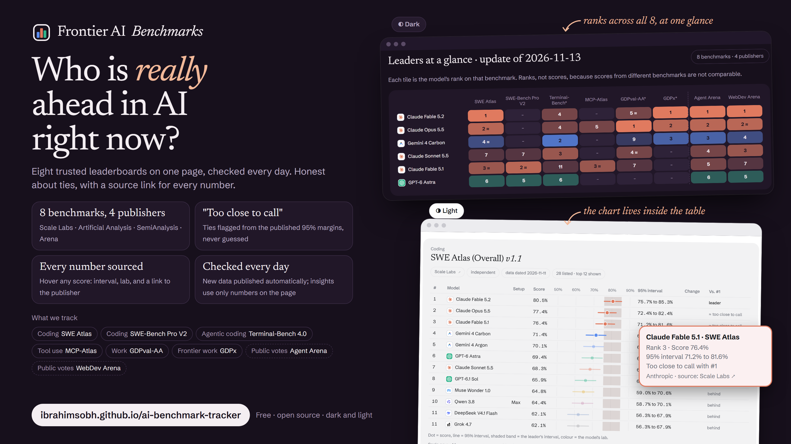

# Frontier AI benchmark tracker

**Website: [ibrahimsobh.github.io/ai-benchmark-tracker](https://ibrahimsobh.github.io/ai-benchmark-tracker/)**

[](https://ibrahimsobh.github.io/ai-benchmark-tracker/)

A tracker comparing frontier AI models on coding, agentic and work benchmarks.
Every number keeps its source link, publisher date and trust label.

**Schedule:** checked every day at 9:00 Cairo time. A new update is published only when a publisher's
data has changed, so the site's "last updated" date can be a few days old. Each update is dated.

## Run it

```
pip install -r requirements.txt
python tracker.py all        # collect + report (exit code 3 = no new data, nothing written)
python tracker.py all --force   # write a new update even if the data did not change
```

Output:
- `data/raw/<date>/`: every raw page/file, as fetched (local only, never committed: see `.gitignore`)
- `data/clean/<date>.csv`: one table, all sources, same columns (public; GDPx trimmed to the top 3)
- `data/alerts/<date>.json`: zero-row, missing-source and old-data alerts
- `reports/<date>-report.md`: the tables file. The script rebuilds it on every run.
- `reports/<date>-insights.md`: the summary and insights, written by the AI from the tables file
  (rules in `prompts/analyze.md`). The script never touches this file.
- `docs/`: the website, built by `python build_site.py` and served by GitHub Pages. Its look follows
  [Coding Agents Digest](https://github.com/IbrahimSobh/coding-agents-digest): same colours, dark/light themes,
  self-hosted Newsreader and Schibsted Grotesk fonts (SIL OFL, `docs/assets/fonts/`) and card tooltips.
  Lab colours and logos are in `bench/labs.py`; logo sources and licences are in `docs/assets/logos/CREDITS.md`. Charts (rank grid
  and score-with-margin charts, `bench/charts.py`) are drawn from `data/clean/` by the script, not by the AI.

## Daily automation

A scheduled Claude task (claude.ai routine) runs **every day at 9:00 Cairo time** and follows
`prompts/daily_task.md`:

1. Collect from all sources.
2. If every row matches the previous run, stop: `tracker.py` prints `NO NEW DATA`, exits with code 3 and
   writes nothing, so nothing is committed or published that day.
3. Otherwise write the tables file and the AI insights, build the site, commit and push to `main`.
   GitHub Pages then publishes `docs/`.

Insights are published without manual review; the site footer says they are AI-written. The site header
shows the date of the latest update and the schedule. The task can also run at any time ("Run now" on the
routine's claude.ai page). A second update on the same day replaces that day's entry. The "Change" column
compares with the earlier update closest to 7 days back (`baseline_csv` in `tracker.py`), so daily updates
never shorten the week-to-week comparison.

## Sources and how each is collected

| Benchmark | Publisher | Method | Margin | Trust |
|---|---|---|---|---|
| SWE Atlas v1.1 (Overall + 3 parts) | Scale | HTML, embedded JSON | ±CI | independent |
| SWE-Bench Pro (Public; CSV only) | Scale | HTML, embedded JSON | ±CI | independent |
| SWE-Bench Pro V2 (Full, Hard) | Scale | HTML, embedded JSON | ±CI | independent |
| MCP-Atlas | Scale (live board) | HTML, embedded JSON | ±CI | independent |
| Terminal-Bench 4.0 | Artificial Analysis | HTML, embedded JSON | none published | independent |
| GDPval-AA v2.1 | Artificial Analysis | HTML, embedded JSON | 95% CI | independent |
| GDPx v1.0 | SemiAnalysis | site's own JSON + GDPx's published formula | none published | independent |
| Agent Arena, WebDev Arena | Arena | official Hugging Face dataset (CC-BY-4.0) | 95% CI | crowd-preference |

### If a source page changes its format

- **One broken board never hides the others:** each board or page is collected on its own. A failure
  becomes an alert ("… failed, other boards kept") and the publisher's other boards still appear.
- **Sanity checks** (`sanity_check` in `tracker.py`) catch pages that still parse but give wrong numbers:
  - a score outside its unit's range (0–100 %, 500–3000 Elo, −1 to 1 score): the row is dropped;
  - a score outside its own margin;
  - a unit change, or a top score more than 2× larger or smaller than in the previous run;
  - fewer than half of the previous run's rows;
  - margins missing when the previous run had them.
- **Alerts reach the commit list:** when the tables file has alerts, the update's commit message starts
  with `⚠ <N> collection alerts` and lists them (`prompts/daily_task.md`).
- If every source fails, nothing is written and the site keeps the latest update.

No source needs Playwright. arena.ai pages sit behind a Cloudflare bot check, so the
Arena collector uses Arena's official dataset instead of the website.

## Model names

`bench/names.py` splits each raw name into a canonical model name and a setup
(effort, harness). Fix mismatches in `model_aliases.json`; the report re-applies names
to past updates too. The report lists names seen at only one publisher, to spot missing aliases.

## Known caveats (checked 2026-11-13)

- **Coding benchmark choice (2026-11-13):** the main coding table is **SWE Atlas (Overall)**: live, 28 models,
  top score 80.5% with published margins. **SWE-Bench Pro V2 (Full)** stays as a second table, with a line
  giving its top score and how many models are too close to call (top scores sit near 99%).
  The old **SWE-Bench Pro (Public)** board is deprecated (newest entry 2026-07-09); it is still collected
  into the CSV but no longer shown in the report. Report alerts only cover tables the report shows.
- **GDPx terms** allow non-commercial quoting with the credit "GDPx by SemiAnalysis", but forbid
  operating "any competing or derivative benchmark, leaderboard, ranking". **Decision (2026-11-13):** the
  public report quotes only the GDPx top 3, with the credit line and a link (`TOP_N_OVERRIDE` in `tracker.py`).
  Because this repo is public, `data/clean/` also keeps only the GDPx top 3.
- **Sources:** every table names and links its publisher, and the site footer credits all four.
  Artificial Analysis and Scale terms of use were not checked in detail; robots.txt allows the pages.
- **Terminal-Bench 4.0** page lists 28 models (the page's default selection).
